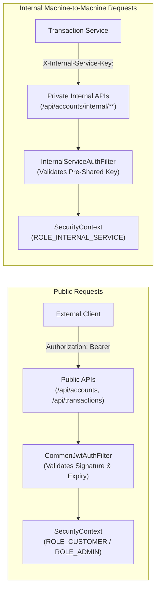
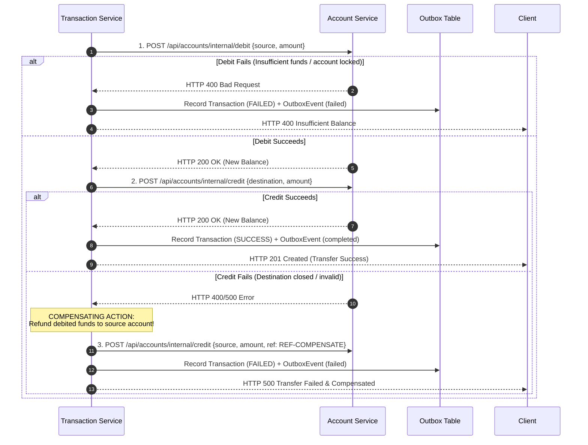

# Digital Banking Platform

[](https://openjdk.org/projects/jdk/21/)
[](https://spring.io/projects/spring-boot)
[](https://spring.io/projects/spring-cloud)
[](https://kafka.apache.org/)
[](https://www.mysql.com/)
[](https://docs.docker.com/compose/)
[](#14-testing-strategy--verified-coverage)

A Java/Spring Boot microservices-based Digital Banking Platform demonstrating secure REST APIs, financial transaction processing, Kafka-based asynchronous communication, Transactional Outbox, idempotency, concurrency control, and service-to-service authentication.

---

## Table of Contents
1. [Project Overview](#1-project-overview)
2. [Key Engineering Concepts Demonstrated](#2-key-engineering-concepts-demonstrated)
3. [Architecture](#3-architecture)
4. [Microservices Breakdown](#4-microservices-breakdown)
5. [Technology Stack](#5-technology-stack)
6. [Security Architecture](#6-security-architecture)
7. [Financial Transactions & Concurrency Control](#7-financial-transactions--concurrency-control)
8. [Transactional Outbox Pattern & Reliability](#8-transactional-outbox-pattern--reliability)
9. [Kafka Event-Driven Architecture](#9-kafka-event-driven-architecture)
10. [Saga & Transfer Compensation](#10-saga--transfer-compensation)
11. [Idempotency Architecture & Deduplication](#11-idempotency-architecture--deduplication)
12. [Database Design & Schema Isolation](#12-database-design--schema-isolation)
13. [API Documentation](#13-api-documentation)
14. [Testing Strategy & Verified Coverage](#14-testing-strategy--verified-coverage)
15. [Docker & Containerized Infrastructure](#15-docker--containerized-infrastructure)
16. [CI/CD Pipeline](#16-cicd-pipeline)
17. [End-to-End API Usage Guide (cURL)](#17-end-to-end-api-usage-guide-curl)
18. [Local Setup & Execution](#18-local-setup--execution)
19. [Environment Configuration Reference](#19-environment-configuration-reference)
20. [Known Limitations & Engineering Trade-offs](#20-known-limitations--engineering-trade-offs)
21. [Future Improvements](#21-future-improvements)
22. [Interview-Ready Master Guide: 20 Core Architectural Questions & Answers](#22-interview-ready-master-guide-20-core-architectural-questions--answers)

---

## 1. Project Overview

The **Digital Banking Platform** is an enterprise multi-service banking backend developed to demonstrate core financial systems engineering principles:
* **Domain Segregation**: Independent microservices with isolated bounded contexts and dedicated MySQL schemas (`auth_db`, `customer_db`, `account_db`, `transaction_db`, `notification_db`, `audit_db`).
* **Financial Transaction Safety**: Atomic balance mutations, pessimistic row locking (`SELECT ... FOR UPDATE`), lexicographical lock acquisition to avoid deadlocks, and high-precision `DECIMAL(19, 4)` arithmetic.
* **Guaranteed Event Publishing (Transactional Outbox)**: Atomically writes financial records and domain outbox events in the same database transaction, followed by background polling with row-level locking to publish events to Apache Kafka.
* **Defensive Idempotency**: Cryptographic SHA-256 payload hashing and database unique constraints preventing duplicate debit/credit executions upon client retries or network interruptions.
* **Dual Security Model**: Stateless customer JWT authentication (HMAC-SHA256) combined with explicit machine-to-machine internal service authentication (`X-Internal-Service-Key`) for sensitive internal mutation endpoints.

---

## 2. Key Engineering Concepts Demonstrated

* **Microservices Architecture**: Domain-driven service boundaries with zero cross-database queries or foreign keys.
* **Spring Boot 3.3 & Java 21**: Modern LTS runtime, records, sealed interfaces, and virtual thread readiness.
* **Spring Security & JWT**: Stateless token issuance, BCrypt password hashing, access/refresh token rotation, and role-based access control (`ROLE_CUSTOMER`, `ROLE_ADMIN`, `ROLE_SUPPORT`).
* **Service-to-Service Authentication**: Custom Spring Security filter verifying pre-shared internal keys on private inter-service balance APIs.
* **Concurrency Control**: Deterministic row-level locking (`PESSIMISTIC_WRITE`) preventing lost updates and overdraft race conditions under high concurrency.
* **Transactional Outbox Pattern**: Dual-write prevention eliminating the event-loss window of standard `afterCommit()` hooks.
* **Kafka Event-Driven Architecture**: Asynchronous notification dispatch and regulatory audit logging with dedicated consumer groups, dead-letter topics (`.DLT`), and consumer idempotency.
* **Orchestration & Compensation**: Multi-step money transfer orchestration with automatic compensating refund actions upon downstream failure (Saga pattern without 2PC).
* **Database Migrations (Flyway)**: Version-controlled relational database migrations ensuring repeatable schema evolution.
* **Automated Testing**: Comprehensive test suite with 116 tests covering unit, mock, concurrency, and multi-service integration scenarios.

---

## 3. Architecture

The architecture separates the **synchronous request-response path** (for immediate consistency of balance operations) from the **asynchronous event-driven path** (for eventual consistency of side-effects such as notifications and audit trails).

```mermaid
flowchart TD
    Client["Client (Web / Mobile / Postman)"] -->|HTTPS + JWT Bearer| Gateway["API Gateway (:8080)<br/>Route Matching & Correlation ID"]

    subgraph Synchronous Microservices Tier
        Gateway -->|/api/auth/**| AuthService["Auth Service (:8081)<br/>JWT, BCrypt & RBAC"]
        Gateway -->|/api/customers/**| CustomerService["Customer Service (:8082)<br/>KYC & Profiles"]
        Gateway -->|/api/accounts/**| AccountService["Account Service (:8083)<br/>Pessimistic Row Lock & Ledger"]
        Gateway -->|/api/transactions/**| TxService["Transaction Service (:8084)<br/>Idempotency & Orchestration"]
        Gateway -->|/api/notifications/**| NotificationService["Notification Service (:8085)<br/>Customer Notifications"]
        Gateway -->|/api/audit/**| AuditService["Audit Service (:8086)<br/>Compliance Logs"]
    end

    subgraph Inter-Service Communication
        TxService -->|"POST /api/accounts/internal/debit & credit<br/>(X-Internal-Service-Key)"| AccountService
        AccountService -.->|"GET /api/customers/{id}"| CustomerService
    end

    subgraph Isolated Schemas (MySQL 8.0)
        AuthService --> DB_Auth[("auth_db")]
        CustomerService --> DB_Cust[("customer_db")]
        AccountService --> DB_Acct[("account_db")]
        TxService --> DB_Tx[("transaction_db<br/>(Transactions + Outbox)")]
        NotificationService --> DB_Notif[("notification_db")]
        AuditService --> DB_Audit[("audit_db")]
    end

    subgraph Transactional Outbox & Event Streaming
        DB_Tx -.->|"SELECT ... FOR UPDATE"| OutboxPub["Outbox Publisher<br/>(Scheduled Poller)"]
        OutboxPub -->|"KafkaTemplate.send()<br/>(acks=all)"| Kafka{"Apache Kafka Broker"}
        Kafka -->|"Topic: bank.transaction.completed<br/>Topic: bank.transaction.failed"| NotifConsumer["Notification Consumer<br/>(Idempotent Dedup)"]
        Kafka -->|"Topic: bank.transaction.*<br/>Topic: bank.audit.created"| AuditConsumer["Audit Consumer<br/>(Idempotent Dedup & Masking)"]
        Kafka -->|"Poison Pills / Retries Exhausted"| DLT["Dead Letter Topics<br/>(*.DLT)"]
        NotifConsumer --> DB_Notif
        AuditConsumer --> DB_Audit
    end
```

---

## 4. Microservices Breakdown

| Service | Port | Database Schema | Responsibility |
| :--- | :--- | :--- | :--- |
| **`api-gateway`** | `8080` | *Stateless* | Central reverse proxy, route dispatching, global `X-Correlation-Id` header injection for distributed tracing, and CORS handling. |
| **`auth-service`** | `8081` | `auth_db` | User registration, credential authentication, BCrypt password hashing, JWT token lifecycle (access + refresh token rotation), and RBAC management. |
| **`customer-service`** | `8082` | `customer_db` | Customer profile management, KYC compliance data, contact information, and customer lifecycle status transitions (`ACTIVE`, `SUSPENDED`, `BLOCKED`). |
| **`account-service`** | `8083` | `account_db` | Bank account management (`SAVINGS`, `CURRENT`), balance mutations protected by `PESSIMISTIC_WRITE` row locks, daily transfer limits, and private internal debit/credit endpoints. |
| **`transaction-service`**| `8084` | `transaction_db` | Financial transactions (`DEPOSIT`, `WITHDRAWAL`, `TRANSFER`), `Idempotency-Key` validation with SHA-256 payload hashing, transfer orchestration with compensating rollback, and Transactional Outbox persistence & publishing. |
| **`notification-service`**| `8085` | `notification_db`| Asynchronous consumer of transaction events, multi-channel template generation (SMS, Email), automated retry with backoff, dead-letter routing (`.DLT`), and database deduplication. |
| **`audit-service`** | `8086` | `audit_db` | Central compliance logging. Consumes transaction and audit events from Kafka, persists immutable audit records with sensitive field masking (`password`, `token`, `secret`), and provides regulatory audit queries. |
| **`banking-common`** | N/A | Shared Library | Shared domain exceptions, RFC 7807 problem detail representations, JWT security filters, standard API response DTOs, correlation ID filter, and Kafka event definitions. |

---

## 5. Technology Stack

| Category | Technology | Version / Details |
| :--- | :--- | :--- |
| **Language** | Java | OpenJDK 21 (LTS) |
| **Framework** | Spring Boot | 3.3.4 |
| **Cloud Routing** | Spring Cloud Gateway MVC | 2023.0.3 |
| **Security** | Spring Security | 6.3 (JJWT 0.12.6, BCrypt 12 rounds) |
| **Persistence** | Spring Data JPA / Hibernate | Hibernate 6.5 |
| **Database** | MySQL | 8.0 (InnoDB Engine, ACID row-level locking) |
| **Schema Migration** | Flyway | Version-controlled SQL scripts |
| **Messaging** | Apache Kafka | 3.7.0 (Confluent Platform 7.5.0) |
| **HTTP Client** | Spring `RestClient` | Connection pooled, configured read/connect timeouts |
| **Observability** | Spring Boot Actuator & SLF4J / Logback | Correlation ID tracking via MDC |
| **API Documentation**| Springdoc OpenAPI (Swagger) | 2.6.0 |
| **Testing** | JUnit 5, Mockito, Spring MockMvc, AssertJ | 116 verified unit & integration tests |
| **DevOps & Build** | Apache Maven, Docker Compose, GitHub Actions | Multi-stage Docker builds, automated CI/CD |

---

## 6. Security Architecture

The platform enforces two distinct security models:



### 1. Customer Authentication & Authorization (RBAC)
* **JWT Lifecycle**: Stateless authentication using HMAC-SHA256 signed access tokens (15-minute validity) and cryptographically random UUID refresh tokens (7-day validity persisted in `refresh_tokens`).
* **Password Hashing**: BCrypt with 12 salt rounds protects customer passwords in `auth_db.users`.
* **Role-Based Access Control**:
  * `ROLE_CUSTOMER`: Access own profile, own accounts, and initiate transactions.
  * `ROLE_SUPPORT`: Read-only access to customer profiles and account statements. Cannot mutate balances or alter roles.
  * `ROLE_ADMIN`: Administrative control (lock/block accounts, manage customer status, query compliance audit logs).
* **IDOR (Insecure Direct Object Reference) Protection**: In addition to role validation, endpoints verify `SecurityHelper.ensureCustomerOrAdmin(resourceCustomerId)`. Unless the caller holds `ROLE_ADMIN` or `ROLE_SUPPORT`, `principal.userId` must match the account owner's ID, returning RFC 7807 `403 Forbidden` on unauthorized access.

### 2. Service-to-Service Authentication
* **Protected Endpoints**: `/api/accounts/internal/debit` and `/api/accounts/internal/credit` mutate account balances directly and are never exposed publicly through the gateway.
* **Pre-Shared Key Header**: Caller services (`transaction-service`) transmit a shared secret configured via `${INTERNAL_SERVICE_KEY}` through the `X-Internal-Service-Key` HTTP header.
* **Dedicated Security Filter**: `account-service` registers `InternalServiceAuthFilter` ahead of the default authentication filter. It validates the header against its configured key and assigns `ROLE_INTERNAL_SERVICE`. Requests without a valid key receive HTTP 401 Unauthorized or HTTP 403 Forbidden.
* *Note on Architecture*: This platform uses pre-shared secret key headers within the private Docker/local network. An encrypted mutual TLS (mTLS) service mesh is not implemented and is outlined under [Future Improvements](#21-future-improvements).

---

## 7. Financial Transactions & Concurrency Control

Money operations require strict transactional consistency, concurrency control, and auditability.

### Supported Financial Operations
1. **Deposit**: Increments account balance atomically; validated for positive amount and maximum limits.
2. **Withdrawal**: Validates active account status, verifies sufficient balance, and deducts balance under lock.
3. **Transfer**: Coordinates a debit on the source account and a credit on the destination account with automatic compensation on failure.

### Concurrency Control & Balance Safety
* **Pessimistic Row-Level Locking (`PESSIMISTIC_WRITE`)**: Balance mutations execute `SELECT ... FOR UPDATE` directly on MySQL InnoDB row index records with a 5000ms timeout (`jakarta.persistence.lock.timeout`).
* **Why Pessimistic Locking over Optimistic Locking?**: Optimistic locking (`@Version`) rejects conflicting transactions at commit time, causing high transaction abort rates and retry thrashing under concurrent withdrawals. Pessimistic locking queues competing threads at the database engine level, guaranteeing deterministic, sequential balance evaluation.
* **Deadlock Elimination via Deterministic Ordering**: When a transfer involves two accounts ($Acct_A$ and $Acct_B$), locks are always acquired in lexicographical order ($\min(A, B)$ then $\max(A, B)$). This eliminates circular wait conditions across concurrent bidirectional transfers.
* **Monetary Precision**: All balance and amount columns use `DECIMAL(19, 4)` to prevent IEEE 754 floating-point rounding errors.

---

## 8. Transactional Outbox Pattern & Reliability

In microservices, updating a database and publishing a Kafka message creates a **dual-write problem**:
1. If the database commits but the Kafka publish fails (or JVM crashes), the event is lost forever.
2. If Kafka is published first but the database rolls back, consumers process a phantom transaction.

### Implementation Architecture

```
[ Financial Request ]
         │
         ▼
 ┌──────────────────────────────────────────────────────────┐
 │ Local Database Transaction Boundary                      │
 │                                                          │
 │  1. Update account balance / create transaction record   │
 │  2. Insert OutboxEvent (status = PENDING, payload = JSON)│
 │                                                          │
 │  COMMIT TRANSACTION                                      │
 └──────────────────────────────────────────────────────────┘
         │
         ▼ (DB Committed Atomically)
 ┌──────────────────────────────────────────────────────────┐
 │ OutboxPublisher (Background Scheduled Worker)            │
 │                                                          │
 │  1. SELECT ... FOR UPDATE (Fetch PENDING, batch size 50) │
 │  2. kafkaTemplate.send(topic, key, payload)              │
 │  3. Wait for broker ACK: future.get(5, TimeUnit.SECONDS) │
 │  4. UPDATE outbox_events SET status = PUBLISHED          │
 │                                                          │
 │  On Failure: increment retry_count, log last_error       │
 │              mark FAILED if retry_count >= max_retries   │
 └──────────────────────────────────────────────────────────┘
         │
         ▼ (acks=all)
 [ Apache Kafka Broker ]
```

### Why This Guarantees Reliability
* **Atomic Persistence**: Business record and `OutboxEvent` are committed in the same local ACID transaction. If the transaction rolls back, no outbox event is persisted.
* **Decoupled from Broker Health**: If Kafka is temporarily unreachable, the transaction completes successfully in MySQL. The publisher will deliver the event once Kafka recovers.
* **No Dual-Write Race**: The legacy `afterCommit()` hook has been replaced by the dedicated `OutboxPublisher` polling loop.

### At-Least-Once Delivery & Crash Scenarios
* **At-Least-Once Delivery**: If Kafka accepts the message and acknowledges it, but the application crashes before updating `outbox_events.status = PUBLISHED`, the restarted publisher will claim the pending record again and re-publish.
* **Requirement for Consumer Idempotency**: Because duplicate publication can occur after network partitions or node crashes, **downstream consumers (`notification-service` and `audit-service`) must implement idempotent message handling**.

---

## 9. Kafka Event-Driven Architecture

### Topic Topology

| Topic | Partitions | Key Strategy | Emitting Service | Consumers |
| :--- | :--- | :--- | :--- | :--- |
| `bank.transaction.created` | 3 | `sourceAccount` | `transaction-service` | `banking-audit-group` |
| `bank.transaction.completed` | 3 | `sourceAccount` | `transaction-service` | `banking-notification-group`, `banking-audit-group` |
| `bank.transaction.failed` | 3 | `sourceAccount` | `transaction-service` | `banking-notification-group`, `banking-audit-group` |
| `bank.audit.created` | 3 | `actor` | `auth-service`, `account-service` | `banking-audit-group` |
| `bank.notification.requested`| 3 | `customerId` | External / Internal | `banking-notification-group` |
| `*.DLT` (Dead Letter Topics) | 1 | Preserved | Error Handler | Operational Monitoring |

### Producer & Consumer Configuration
* **Producer Acknowledgement (`acks=all`)**: Ensures all in-sync replicas confirm write before marking the future complete.
* **Producer Idempotence (`enable.idempotence=true`)**: Avoids duplicate broker appends caused by network-level producer retries.
* **Key-Based Partition Ordering**: Partitioning transactions by `sourceAccount` ensures all events for a specific account arrive in chronological order on the same partition.
* **Consumer Error Handling & DLT**: Configured with Spring Kafka's `DefaultErrorHandler` using `FixedBackOff(1000ms, 3)`. Fatal deserialization errors bypass retry loops and route immediately to dead-letter topics.

---

## 10. Saga & Transfer Compensation

Cross-service money transfers between accounts are orchestrated by `transaction-service`:



### Architectural Realities & Limitations
* **No Two-Phase Commit (2PC)**: Distributed locking across microservices is not used. Balance mutations execute as local transactions on individual services.
* **Best-Effort Compensation**: If the compensating refund call to `account-service` fails (e.g. database network outage), the system records the failure in the transaction ledger.
* **Reconciliation Requirement**: Under catastrophic infrastructure failure during compensation, automated compensation may fail. Operational reconciliation jobs or manual administrative intervention are required to resolve orphaned balances.

---

## 11. Idempotency Architecture & Deduplication

### 1. Client-Facing API Idempotency
Mutating endpoints (`/deposit`, `/withdraw`, `/transfer`) require an `Idempotency-Key: <UUID>` header.
1. **Cryptographic Payload Hash**: Upon arrival, `IdempotencyService` computes the **SHA-256** hash of the incoming request body.
2. **Database Unique Constraint**: An insertion is attempted into `idempotency_records` (`idempotency_key` has a `UNIQUE INDEX`).
   * **Concurrent Race**: If two identical requests arrive simultaneously, the second insert fails with `DataIntegrityViolationException` and returns **HTTP 409 Conflict** (`"A transaction with this idempotency key is currently being processed"`).
   * **Payload Mismatch**: If an existing key is reused with a different request payload, the system detects the hash mismatch and returns **HTTP 409 Conflict** (`"Idempotency key has already been used with a different request payload"`).
   * **Completed Replay**: If the previous execution finished (`status = COMPLETED`), the cached response payload and status code are returned immediately without re-executing the financial operation.

### 2. Downstream Kafka Consumer Deduplication
Because Kafka event publishing guarantees at-least-once delivery:
* **`NotificationService`**: Checks `findFirstByTransactionReference(txRef)`. If a notification has already been processed for this transaction, the event is skipped.
* **`AuditService`**: Checks `findFirstByActionAndResourceTypeAndResourceIdAndStatus(...)`. If an audit record with matching parameters exists, duplicate insertion is suppressed.

---

## 12. Database Design & Schema Isolation

Each microservice connects exclusively to its own schema. **Cross-database joins and shared foreign keys are strictly prohibited.**

```
auth_db
├── users (id, username, email, password_hash, status, created_at, updated_at)
├── roles (id, name)
├── user_roles (user_id, role_id)
└── refresh_tokens (id, user_id, token, expiry_date, revoked)

customer_db
└── customers (id, customer_number, user_id, first_name, last_name, email, phone, date_of_birth, status, address, created_at, updated_at)

account_db
├── accounts (id, account_number, customer_id, account_type, balance, currency, status, version, created_at, updated_at)
└── account_limits (id, account_id, daily_transfer_limit, single_tx_limit, updated_at)

transaction_db
├── transactions (id, transaction_reference, idempotency_key, source_account, destination_account, amount, currency, transaction_type, status, failure_reason, created_at, completed_at)
├── idempotency_records (id, idempotency_key, resource_type, request_hash, response_payload, status_code, status, created_at)
└── outbox_events (id, event_id, aggregate_type, aggregate_id, event_type, topic, payload, status, created_at, published_at, retry_count, last_error)

notification_db
└── notifications (id, customer_id, transaction_id, notification_type, recipient, subject, message, status, retry_count, created_at)

audit_db
└── audit_logs (id, correlation_id, actor, action, resource_type, resource_id, status, ip_address, metadata, created_at)
```

* **Flyway Migrations**: Each service executes migrations from `classpath:db/migration` on startup, guaranteeing schema versioning across development, test, and production environments.

---

## 13. API Documentation

All microservices are accessible via the unified API Gateway (`http://localhost:8080`).

| Service | Method | Endpoint | Description | Auth / Roles |
| :--- | :--- | :--- | :--- | :--- |
| **Auth** | `POST` | `/api/auth/register` | Register new customer account | Public |
| **Auth** | `POST` | `/api/auth/login` | Authenticate & obtain access/refresh JWT | Public |
| **Auth** | `POST` | `/api/auth/refresh` | Refresh expired access token | Public |
| **Auth** | `GET` | `/api/auth/me` | Fetch authenticated user details | `CUSTOMER`, `ADMIN`, `SUPPORT` |
| **Auth** | `POST` | `/api/auth/logout` | Revoke refresh token | Authenticated |
| **Customer** | `POST` | `/api/customers` | Create KYC customer profile | `CUSTOMER`, `ADMIN` |
| **Customer** | `GET` | `/api/customers/{id}` | Get customer profile by ID | Owner, `ADMIN`, `SUPPORT` |
| **Customer** | `GET` | `/api/customers/by-user/{userId}` | Get customer profile by User ID | Owner, `ADMIN`, `SUPPORT` |
| **Customer** | `PATCH`| `/api/customers/{id}/status` | Update customer status (`ACTIVE`, `SUSPENDED`) | `ADMIN` |
| **Account** | `POST` | `/api/accounts` | Open bank account (`SAVINGS`, `CURRENT`) | `CUSTOMER`, `ADMIN` |
| **Account** | `GET` | `/api/accounts/{accountNumber}` | Get account details and balance | Owner, `ADMIN`, `SUPPORT` |
| **Account** | `GET` | `/api/accounts/customer/{customerId}` | List accounts for customer | Owner, `ADMIN`, `SUPPORT` |
| **Account** | `PATCH`| `/api/accounts/{accountNumber}/status` | Update account status (`ACTIVE`, `CLOSED`) | `ADMIN` |
| **Account** | `POST` | `/api/accounts/internal/debit` | Internal atomic debit *(Direct Service Only)* | `ROLE_INTERNAL_SERVICE` |
| **Account** | `POST` | `/api/accounts/internal/credit` | Internal atomic credit *(Direct Service Only)*| `ROLE_INTERNAL_SERVICE` |
| **Transaction**| `POST`| `/api/transactions/deposit` | Deposit funds (`Idempotency-Key` required) | `CUSTOMER`, `ADMIN` |
| **Transaction**| `POST`| `/api/transactions/withdraw` | Withdraw funds (`Idempotency-Key` required)| `CUSTOMER`, `ADMIN` |
| **Transaction**| `POST`| `/api/transactions/transfer` | Intra-bank transfer (`Idempotency-Key` req)| `CUSTOMER`, `ADMIN` |
| **Transaction**| `GET` | `/api/transactions/{ref}` | Get transaction by reference | Owner, `ADMIN`, `SUPPORT` |
| **Transaction**| `GET` | `/api/transactions/account/{accNo}`| List transactions for account | Owner, `ADMIN`, `SUPPORT` |
| **Notification**| `GET`| `/api/notifications/customer/{id}` | List customer notifications | Owner, `ADMIN`, `SUPPORT` |
| **Audit** | `GET` | `/api/audit/logs` | Query compliance audit ledger (paginated) | `ADMIN`, `SUPPORT` |
| **Audit** | `GET` | `/api/audit/resource/{type}/{id}` | View audit history for resource | `ADMIN`, `SUPPORT` |

---

## 14. Testing Strategy & Verified Coverage

The platform maintains an automated test suite verifying business logic, security constraints, pessimistic locking concurrency, failure scenarios, and the Transactional Outbox pattern.

### Test Results
```text
[INFO] Reactor Summary for digital-banking-platform 1.0.0-SNAPSHOT:
[INFO] 
[INFO] digital-banking-platform ........................... SUCCESS
[INFO] banking-common ..................................... SUCCESS [ 2 tests ]
[INFO] api-gateway ........................................ SUCCESS [ 2 tests ]
[INFO] auth-service ....................................... SUCCESS [ 4 tests ]
[INFO] customer-service ................................... SUCCESS [ 6 tests ]
[INFO] account-service .................................... SUCCESS [ 16 tests ]
[INFO] transaction-service ................................ SUCCESS [ 67 tests ]
[INFO] notification-service ............................... SUCCESS [ 8 tests ]
[INFO] audit-service ...................................... SUCCESS [ 11 tests ]
[INFO] ------------------------------------------------------------------------
[INFO] BUILD SUCCESS
```

- **Total Tests**: **116**
- **Failures**: **0**
- **Errors**: **0**
- **Skipped**: **0**

### Key Test Suites
* `OutboxPublisherTest`: Verifies scheduled polling, pessimistic lock claiming, Kafka acknowledgement handling, retry count incrementing, and failure status transitions.
* `TransactionOutboxAtomicityIntegrationTest`: Confirms that business transaction records and `OutboxEvent` records are committed atomically within the same database transaction.
* `OutboxEventRepositoryTest`: Verifies FIFO ordering (`created_at ASC, id ASC`) and pessimistic row locking query behavior.
* `TransactionFailureScenariosTest`: Tests transfer compensation, insufficient balances, account status rejections, and network timeouts.
* `AccountControllerIntegrationTest`: Verifies pessimistic row locking under concurrent debits and validates `X-Internal-Service-Key` header authentication.

---

## 15. Docker & Containerized Infrastructure

All infrastructure components and microservices can be orchestrated using `docker-compose.yml`:
* **MySQL 8.0**: Auto-initializes all 6 microservice databases via `docker/mysql/init.sql`.
* **Apache Kafka & Zookeeper**: Confluent Platform 7.5.0 with automatic topic provisioning (`init-kafka`).
* **Multi-Stage Dockerfiles**: Services use Eclipse Temurin 21 JRE images for minimal container attack surface and fast startup.

```bash
# Build JARs and start the complete ecosystem
mvn clean package -DskipTests
docker compose up -d --build

# Inspect container status
docker compose ps
```

---

## 16. CI/CD Pipeline

The project includes an automated GitHub Actions pipeline (`.github/workflows/ci.yml`):
1. Triggers on push and pull request to `main`, `master`, and `develop`.
2. Sets up OpenJDK 21 Temurin with Maven dependency caching.
3. Compiles the multi-module project (`mvn clean compile`).
4. Executes all 116 unit and integration tests (`mvn test`).
5. Packages production JAR artifacts and uploads test reports.

---

## 17. End-to-End API Usage Guide (cURL)

Below is an end-to-end walkthrough for testing through the API Gateway (`:8080`).

### 1. Register User
```bash
curl -X POST http://localhost:8080/api/auth/register \
  -H "Content-Type: application/json" \
  -d '{
    "username": "jane_doe",
    "email": "jane.doe@bank.com",
    "password": "SecurePassword123!",
    "role": "ROLE_CUSTOMER"
  }'
```

### 2. Login & Obtain JWT Token
```bash
curl -X POST http://localhost:8080/api/auth/login \
  -H "Content-Type: application/json" \
  -d '{
    "username": "jane_doe",
    "password": "SecurePassword123!"
  }'
```
*Save the access token:*
```bash
export TOKEN="<access-token-from-response>"
```

### 3. Create Customer Profile
```bash
curl -X POST http://localhost:8080/api/customers \
  -H "Authorization: Bearer $TOKEN" \
  -H "Content-Type: application/json" \
  -d '{
    "userId": 1,
    "firstName": "Jane",
    "lastName": "Doe",
    "email": "jane.doe@bank.com",
    "phone": "+1234567890",
    "dateOfBirth": "1992-08-20",
    "address": "200 Financial Way, New York, NY"
  }'
```

### 4. Open Bank Accounts
```bash
# Open Source Savings Account ($1000)
curl -X POST http://localhost:8080/api/accounts \
  -H "Authorization: Bearer $TOKEN" \
  -H "Content-Type: application/json" \
  -d '{"customerId": 1, "accountType": "SAVINGS", "currency": "USD", "initialDeposit": 1000.00}'

# Open Destination Current Account ($200)
curl -X POST http://localhost:8080/api/accounts \
  -H "Authorization: Bearer $TOKEN" \
  -H "Content-Type: application/json" \
  -d '{"customerId": 1, "accountType": "CURRENT", "currency": "USD", "initialDeposit": 200.00}'
```

### 5. Execute Idempotent Money Transfer
```bash
curl -X POST http://localhost:8080/api/transactions/transfer \
  -H "Authorization: Bearer $TOKEN" \
  -H "Content-Type: application/json" \
  -H "Idempotency-Key: e6a42f6c-69f7-41e1-8871-2b08534e6268" \
  -d '{
    "sourceAccount": "ACC10000001",
    "destinationAccount": "ACC10000002",
    "amount": 250.00,
    "currency": "USD",
    "description": "Consulting invoice payment"
  }'
```

### 6. Verify Idempotency Deduplication
Re-send the exact same cURL command with the identical `Idempotency-Key`.
*Result*: The platform returns HTTP 201 with the original cached response without performing a second $250 debit.

---

## 18. Local Setup & Execution

### Prerequisites
* **Java**: OpenJDK 21 or higher
* **Maven**: 3.9+
* **Docker & Docker Compose**: 24+

### Setup Instructions

1. **Clone the repository**:
   ```bash
   git clone https://github.com/ashok9847/digital-banking-platform.git
   cd digital-banking-platform
   ```

2. **Configure Environment Variables**:
   Copy the example environment template to `.env`:
   ```bash
   cp .env.example .env
   ```
   Edit `.env` to configure your local MySQL password, JWT signing key, and internal service key.

3. **Start Infrastructure (MySQL & Kafka)**:
   ```bash
   docker compose up -d mysql zookeeper kafka init-kafka
   ```

4. **Build and Run All Tests**:
   ```bash
   mvn clean verify
   ```

5. **Start Microservices**:
   *Option A: Run everything in Docker*:
   ```bash
   docker compose up -d --build
   ```
   *Option B: Run services locally with Maven*:
   ```bash
   mvn spring-boot:run -pl auth-service
   mvn spring-boot:run -pl customer-service
   mvn spring-boot:run -pl account-service
   mvn spring-boot:run -pl transaction-service
   mvn spring-boot:run -pl notification-service
   mvn spring-boot:run -pl audit-service
   mvn spring-boot:run -pl api-gateway
   ```

6. **Access Platform**:
   The API Gateway is reachable at `http://localhost:8080`.

---

## 19. Environment Configuration Reference

| Environment Variable | Description | Safe Example / Default |
| :--- | :--- | :--- |
| `SPRING_PROFILES_ACTIVE` | Active Spring profile | `default` (or `docker`, `test`) |
| `SPRING_DATASOURCE_URL` | JDBC database connection string | `jdbc:mysql://localhost:3306/{service_db}` |
| `SPRING_DATASOURCE_USERNAME` | MySQL database username | `root` (or `bank_user`) |
| `SPRING_DATASOURCE_PASSWORD` | MySQL database password | Configured via `.env` |
| `SPRING_KAFKA_BOOTSTRAP_SERVERS`| Kafka broker address | `localhost:9092` (or `kafka:29092`) |
| `JWT_SECRET` | 256-bit Base64-encoded secret key for HMAC-SHA256 | Configured via `.env` |
| `JWT_EXPIRATION_MS` | Access token lifespan in milliseconds | `900000` (15 minutes) |
| `JWT_REFRESH_EXPIRATION_MS` | Refresh token lifespan in milliseconds | `604800000` (7 days) |
| `INTERNAL_SERVICE_KEY` | Pre-shared key for private internal service endpoints | Configured via `.env` |

---

## 20. Known Limitations & Engineering Trade-offs

* **At-Least-Once Delivery Semantics**: The Transactional Outbox pattern and Kafka deliver messages with **at-least-once** guarantees. In crash-after-send scenarios (where Kafka acknowledges receipt but the application crashes before updating `outbox_events.status = PUBLISHED`), duplicate messages can be published upon restart. Downstream consumers must remain strictly idempotent.
* **Eventual Consistency Latency**: Outbox events are dispatched by a scheduled polling worker (`fixed-delay-ms: 1000`). Eventual consistency exists between the financial database commit and consumer notification/audit persistence.
* **Orchestration Without 2PC**: Transfers rely on orchestrated compensating actions rather than two-phase commit (2PC) to preserve microservice availability and isolation. If a compensating credit fails due to unrecoverable infrastructure failure, manual reconciliation is required.
* **Service-to-Service Authentication**: Internal endpoints authenticate via a shared pre-shared secret key header (`X-Internal-Service-Key`) within the internal network perimeter rather than an encrypted mutual TLS (mTLS) service mesh.

---

## 21. Future Improvements

* **Mutual TLS (mTLS) & Service Mesh**: Transitioning from shared HTTP service keys to Kubernetes with Istio sidecars for cryptographic service identity (SPIFFE/SPIRE).
* **Automated Reconciliation Worker**: Scheduled reconciliation jobs comparing ledger balances across `account-service` and `transaction-service` to detect and alert on orphaned transfer states.
* **Partitioned Outbox Claiming**: Enhancing the Outbox Publisher with distributed lock mechanisms (e.g. ShedLock or Kafka partition assignment) for high-scale multi-instance publisher deployments.
* **Distributed Tracing**: Integration of OpenTelemetry (OTel) collectors, Prometheus metrics, and Grafana dashboards with the existing `X-Correlation-Id` MDC headers.
* **Centralized Secrets Management**: Integrating HashiCorp Vault or cloud key management services (AWS KMS / GCP Secret Manager) to automate credential rotation.

---

## Author

**Ashok Aryal**
- GitHub: [@ashok9847](https://github.com/ashok9847)

---

## License

This project is licensed under the MIT License. See [LICENSE](LICENSE) for details.
